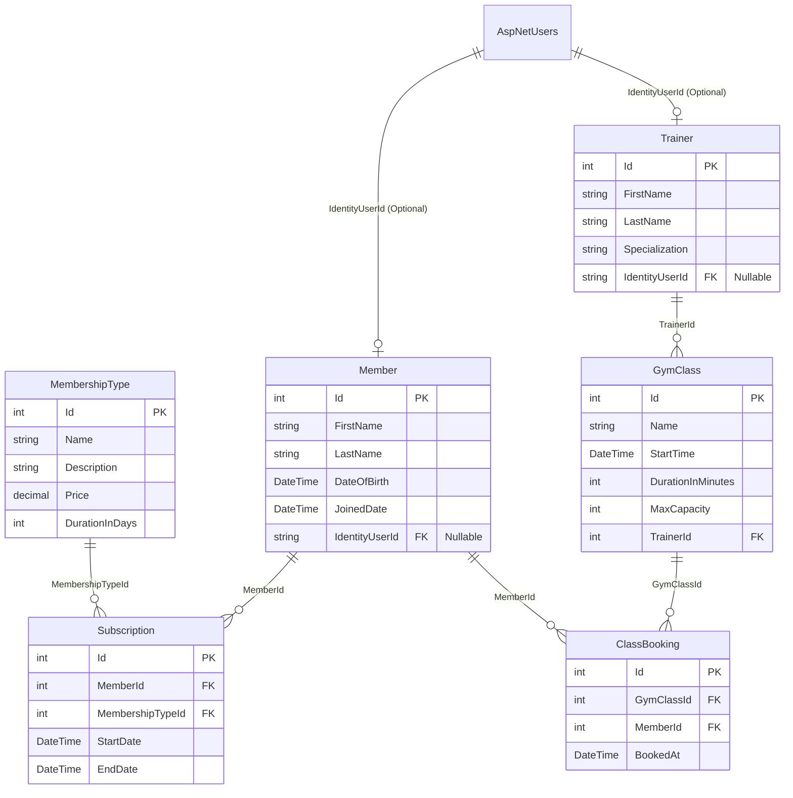

# 🏋️ GymManagement — Developer Onboarding & Workflow Guide

Welcome to the **GymManagement** development team! This guide will help you get your local environment running, understand our database architecture, and outline our team workflow.

---

## 🛠️ Prerequisites

Make sure you have the following installed on your machine:
* **.NET 8 SDK**
* **JetBrains Rider** (or VS Code / Visual Studio 2022)
* **Git**

---

## 🚀 Quickstart Setup

### 1. Clone the Repository
Open your terminal and run:
```bash
git clone git@gitlab.com:stefan_1-group/gymmanagement.git
cd gymmanagement
```

### 2. Restore Dependencies
Restore all NuGet packages required for the project:
```bash
dotnet restore
```

### 3. Initialize & Seed Database
We use **SQLite** (`app.db`) for lightweight local development. Run EF Core migrations to generate the local database file and seed initial data:
```bash
dotnet ef database update
```
*(If `dotnet ef` command is not recognized, install the global tool using: `dotnet tool install --global dotnet-ef`)*

### 4. Run the Project
Start the application locally:
```bash
dotnet run --project GymManagement
```
Open your browser and navigate to `https://localhost:5001` or `http://localhost:5000`.

---

## 🔑 Default Test Credentials

Upon first startup, `DbInitializer` automatically seeds standard roles and test accounts into SQLite:

| Role | Email / Username | Password |
| :--- | :--- | :--- |
| **Admin** | `admin@gym.com` | `Admin123!` |
| **Trainer** | `john.doe@gym.com` | `Trainer123!` |
| **Trainer** | `sarah.smith@gym.com` | `Trainer123!` |

---

## 🗄️ Database Architecture & ERD

Our domain layer inside `Models/` covers 6 core entities integrated with ASP.NET Core Identity (`AspNetUsers`):

* **`Member`**: Gym member profile linked to ASP.NET Core Identity.
* **`Trainer`**: Instructor record linked to ASP.NET Core Identity.
* **`MembershipType`**: Available subscription plans (Basic, VIP, Annual).
* **`Subscription`**: Tracks active/past memberships for Members.
* **`GymClass`**: Scheduled training sessions assigned to a Trainer.
* **`ClassBooking`**: Join table tracking Member reservations for GymClasses.

### Interactive Mermaid ERD



### Quick Table & Key Relationships Reference

```
                 ┌──────────────────┐
                 │   AspNetUsers    │
                 └────────┬─────────┘
                          │ 0..1
          ┌───────────────┴───────────────┐
     0..1 │                          0..1 │
┌─────────┴────────┐             ┌────────┴────────┐
│     Member       │             │     Trainer     │
└────────┬─────────┘             └────────┬────────┘
         │ 1                              │ 1
   ┌─────┴────────┐                       │
 * │            * │                     * │
┌──┴───────────┐ ┌┴──────────────┐   ┌────┴────────────┐
│ Subscription │ │ ClassBooking  │   │    GymClass     │
└──┬───────────┘ └▲──────────────┘   └────▲────────────┘
   │ *            │ *                     │ 1
   │              └───────────────────────┘
┌──┴──────────────┐
│ MembershipType  │
└─────────────────┘
```

---

## 📐 EF Core Migration Guidelines

To prevent database merge conflicts between team members:

1. **Pull before migrating:** Always run `git pull origin main` before creating a new migration.
2. **Add migrations via CLI:**
   ```bash
   dotnet ef migrations add <DescriptiveMigrationName>
   ```
3. **Commit Migrations:** Always commit the generated `Migrations/` folder to Git so teammates stay in sync.
4. **Never alter published migrations:** Do not delete or manually alter existing migration files once pushed to `main`.

---

## 🌿 Git Branching Workflow

1. Always pull the latest changes from `main`:
   ```bash
   git checkout main
   git pull origin main
   ```
2. Create a new branch for your feature/bugfix:
   ```bash
   git checkout -b feature/your-feature-name
   ```
3. Commit your work frequently:
   ```bash
   git add .
   git commit -m "Add feature description"
   ```
4. Push your branch and create a **Merge Request (MR)** on GitLab:
   ```bash
   git push -u origin feature/your-feature-name
   ```

---

## 📂 Folder Hierarchy

```GymManagement/
├── Areas/             # Area modules (Admin, Trainer, Member)
├── Controllers/       # MVC Controllers
├── Data/              # DbContext & DbInitializer
├── Models/            # EF Core Domain Entities
├── Views/             # Razor Views & Layouts
├── ViewModels/        # View Models (DTOs)
├── appsettings.json   # Connection string & app settings
└── Program.cs         # App configuration & DI setup
```